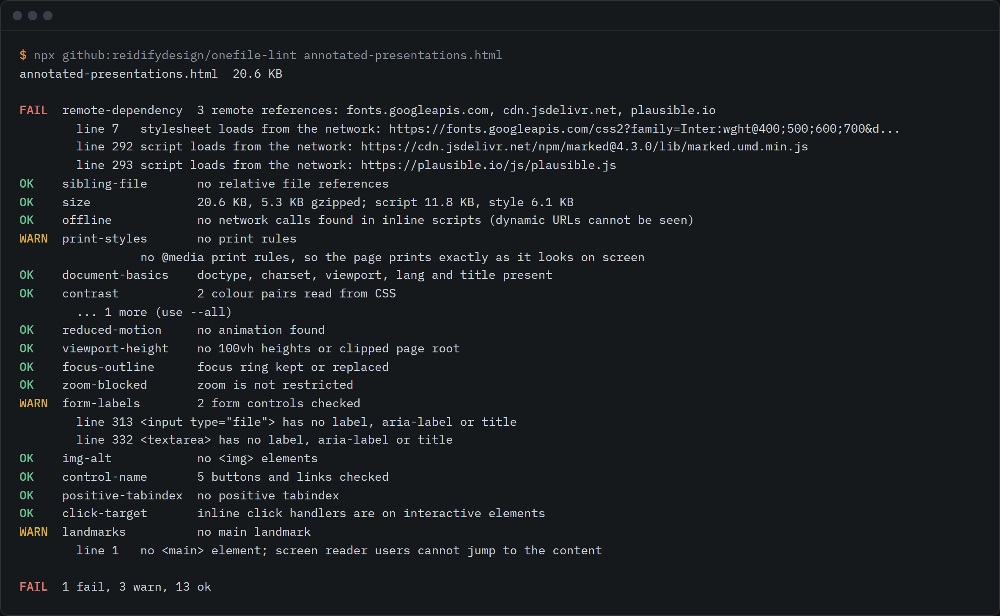

# onefile-lint

Lints agent-made single-file HTML pages for remote dependencies, size, contrast, reduced motion, print and offline use.



```sh
npx github:reidifydesign/onefile-lint page.html
```

No install, no dependencies, Node 18 or newer. Point it at a file, a folder, a URL, or `-` for stdin. It exits 0 on a pass, 1 when a page fails, and 2 on bad input, so it works in CI and in an agent's own loop.

## Why this exists

On 22 July 2026 a full presentation tool delivered as one HTML file reached 1,033 points on [Hacker News](https://news.ycombinator.com/item?id=49008211), and commenters singled out offline use. Agents now produce pages like that all day: Simon Willison's [tools](https://github.com/simonw/tools) repo is 237 single-file pages that it describes as "almost entirely generated using LLMs".

A one-file page is only useful if it stays one file. A CDN script tag, a web font, a relative `style.css` or a dark theme that prints as white-on-white each break it in a different way, and the agent that wrote it rarely says so. General validators such as html-validate check markup. On 30 Sep 2026 I searched GitHub and npm for a linter that checks remote dependencies, offline use and print together and did not find one, so this is that check.

What it found on its first real run, on 30 Sep 2026, across those 237 pages (commit `83a5d43`):

- 75 (32%) load something from another host, and 12 more point at files next to the page.
- 187 (79%) have no print styles, and 79 (33%) have motion with no reduced-motion path.
- Just 3 pass every rule. The full table is in [the catalogue](catalogue/CATALOGUE.md), and the per-page data is in [`data/`](data/).

These are counts of what a static check can see in one author's pages. They are not a measure of how agents behave in general.

## Use it

```sh
onefile-lint page.html                     # one page
onefile-lint ./dist --strict               # every .html under a folder, fail on warnings too
onefile-lint https://example.com/tool.html # fetch and lint a URL
cat page.html | onefile-lint -             # stdin
onefile-lint page.html --format json       # for tools; also: markdown, for pull request comments
onefile-lint explain contrast              # what a rule checks, why, and the evidence behind it
```

The rules, in three groups:

| Group | Rules |
| --- | --- |
| portability | `remote-dependency`, `sibling-file`, `size`, `offline`, `print-styles`, `document-basics` |
| display | `contrast`, `reduced-motion`, `viewport-height`, `focus-outline`, `zoom-blocked` |
| robustness | `form-labels`, `img-alt`, `control-name`, `positive-tabindex`, `click-target`, `landmarks` |

Options:

| Option | What it does |
| --- | --- |
| `--skip a,b` / `--only a,b` | Skip or run only these rules or groups, for example `--skip contrast` or `--only portability` |
| `--allow-host a.com,b.com` | Do not count remote references to hosts you accept, such as a CDN you have decided to trust |
| `--warn-kb N` / `--fail-kb N` | Size limits in KB. Defaults are 1024 and 5120, which are this tool's choice, not a standard |
| `--strict` | Exit 1 on warnings as well as failures |
| `--all` | Show every finding. Text output shows three per rule |
| `--format text\|json\|markdown` | Output format |

As a library: `import { lint } from 'onefile-lint'` and call `lint(htmlString, options)`. It returns the same results the CLI prints.

### The rule catalogue

[`catalogue/CATALOGUE.md`](catalogue/CATALOGUE.md) lists every check with what it looks for, why, its limits, and the evidence behind it. Each claim is graded: A for measured on AI-generated pages, B for measured on the wider web or named in a standard, C for practitioner reports, D for no public evidence found. Frequencies appear only where a source states them, and a D entry says so instead of guessing. Three known agent failures the linter cannot check without a browser are listed there too.

### The single-file apps list

[`awesome/`](awesome/README.md) is a list of single-file web apps where the size, offline status and licence are checked by script, not by opinion. A page is listed only if it passes the remote-dependency and sibling-file rules. `npm run list:refresh` rechecks it, and a monthly workflow in `.github/workflows/monthly-list.yml` does the same and opens a pull request. That workflow is switched off until the repo launches.

## What it does not do

- It reads text, it does not render the page. Contrast is computed from CSS colour pairs in the same rule. Gradients, images, `color-mix()`, `lab()` and text on cards over other backgrounds are skipped, never guessed. A tool that renders the page will find more.
- It cannot see URLs that a script builds at run time, or event listeners added with `addEventListener`.
- Several checks are judgment calls, not failures: a hero section at `100vh`, an app that calls an API on purpose, and a `requestAnimationFrame` loop for a game all trigger warnings. Warnings do not fail a page unless you pass `--strict`.
- It is not a full accessibility audit. It checks the failures agents repeat, and several of them overlap with accessibility, but it does not judge alt text quality, ARIA correctness, dialog focus handling or reading order.
- The first corpus is one author's 237 pages. The evidence grades in the catalogue say where numbers come from and where none exist.

## Develop

```sh
npm test                 # node:test, no network needed
npm run corpus           # lint a public repo's pages and write a summary to data/
npm run catalogue        # rebuild catalogue/CATALOGUE.md from rules.json and the newest corpus run
npm run list:refresh     # recheck the single-file apps list
```

## Licence

MIT. Built by [@rishsadh](https://github.com/rishsadh) at [Reidify](https://reidify.design).
